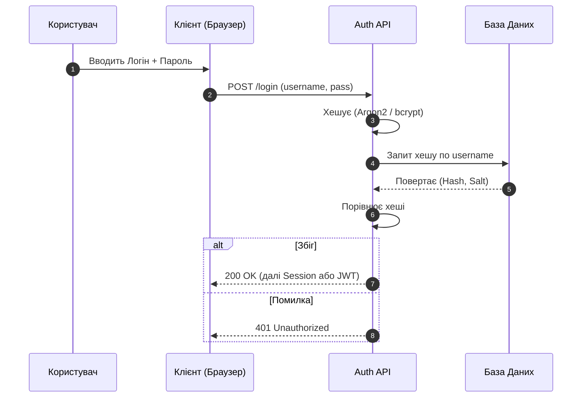
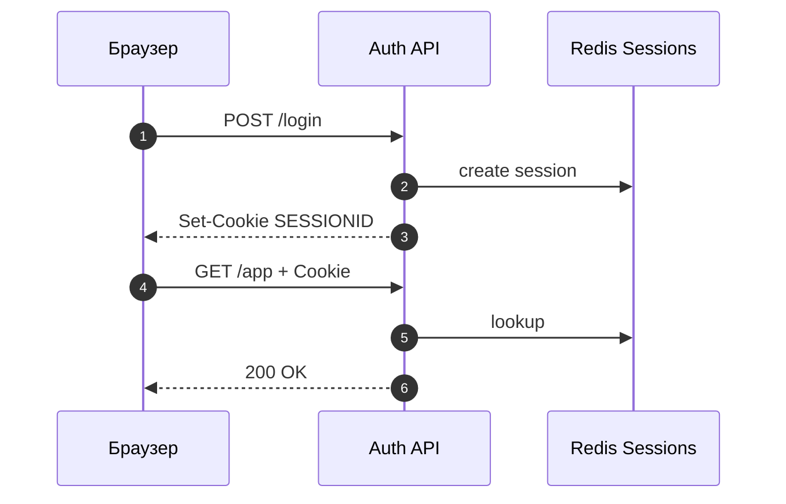
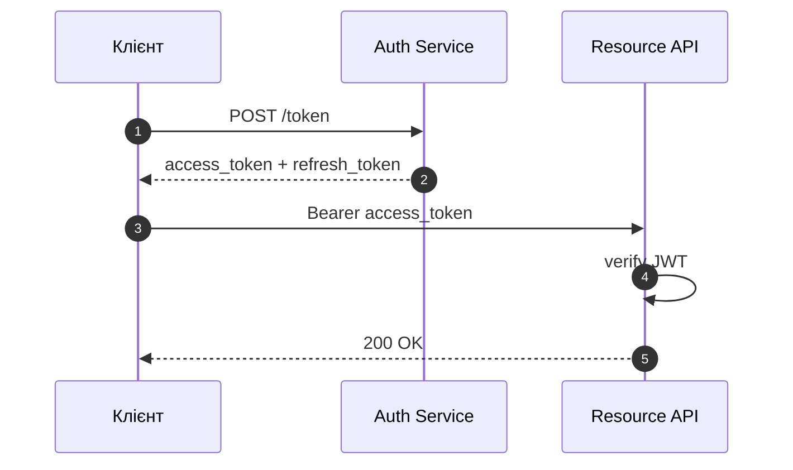
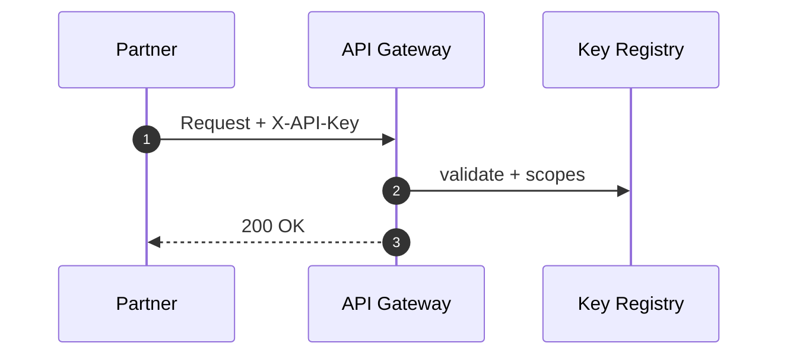
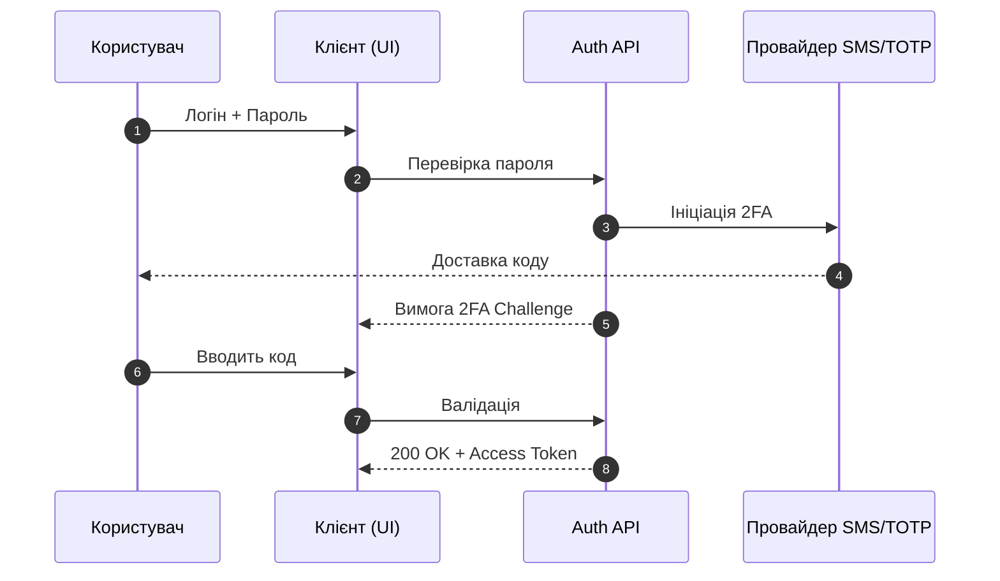
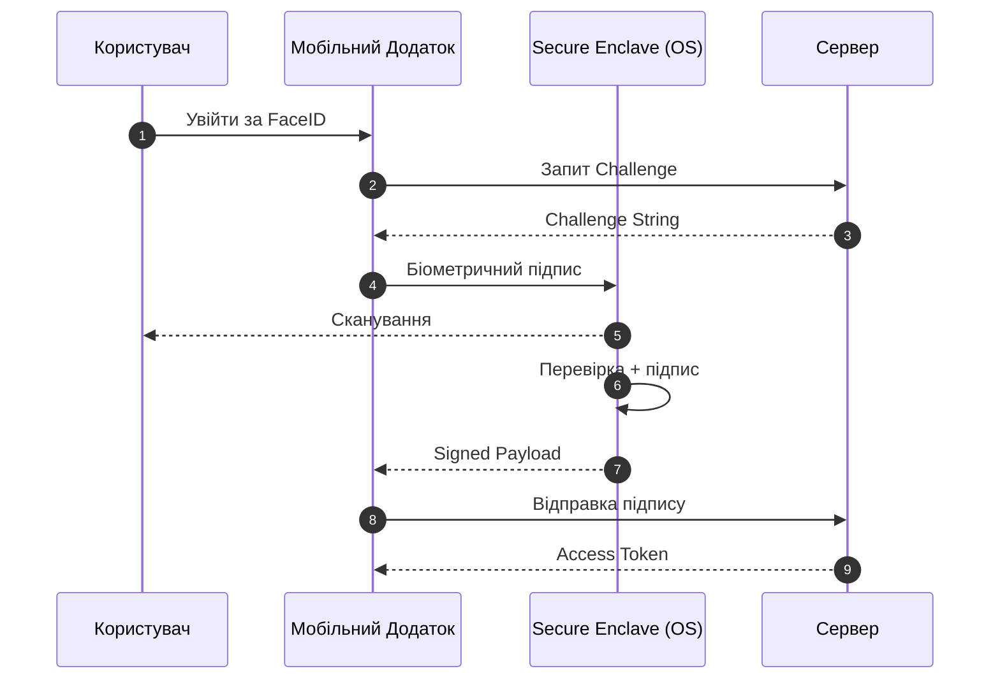
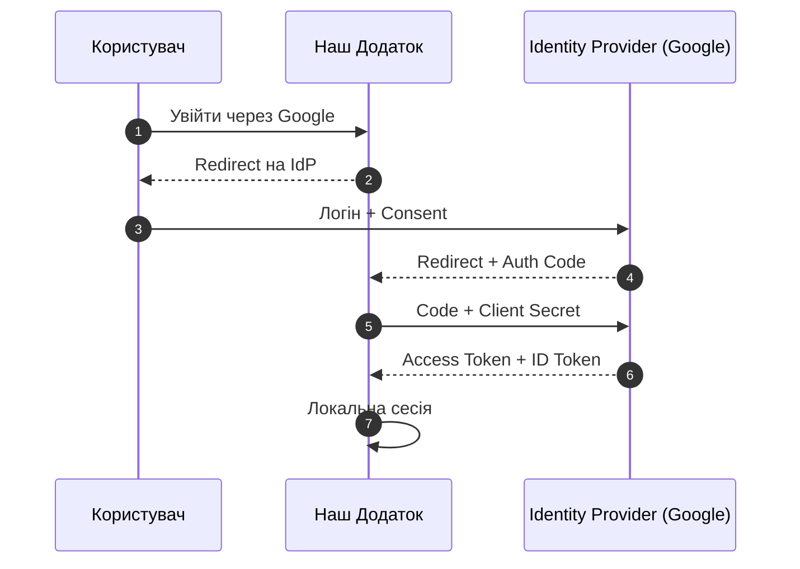
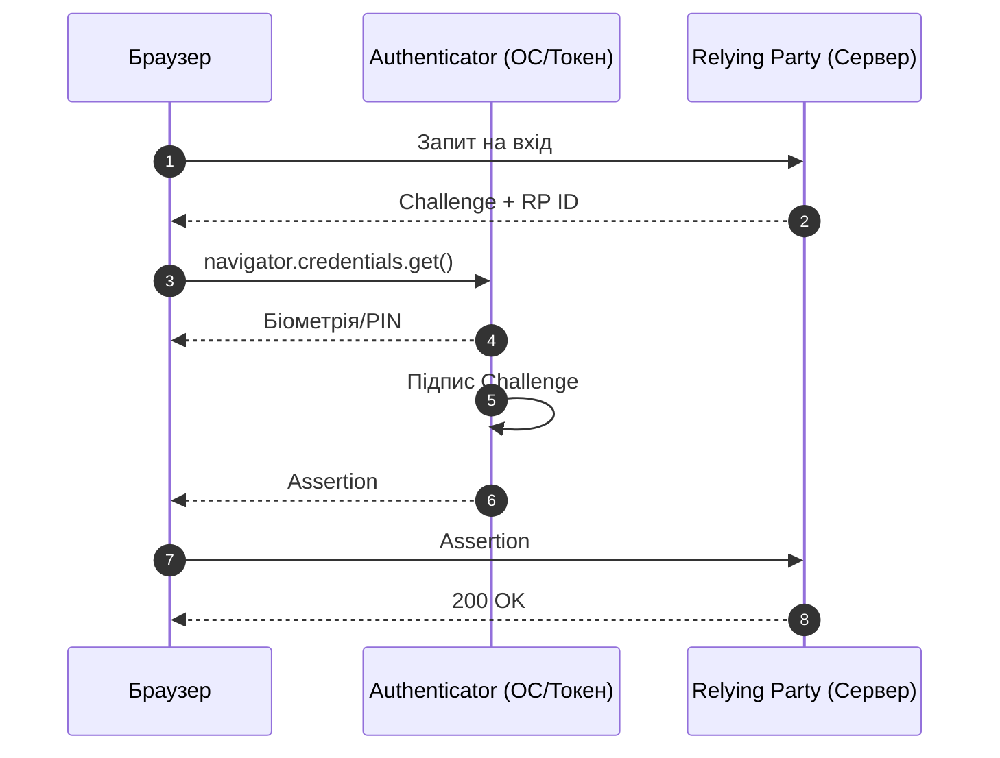
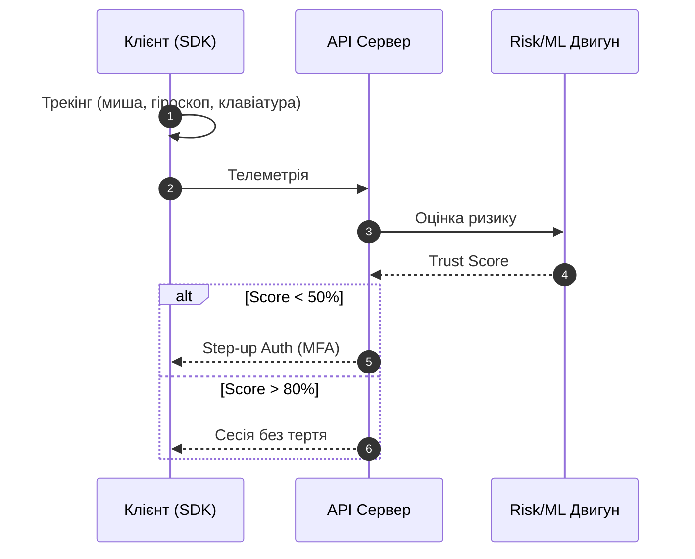

# Дослідження методів автентифікації (2026)

> **Статус:** фінальний звіт (Deep Research)  
> **Домен:** архітектура безпеки, IAM (Identity and Access Management)  
> **Публічна сторінка:** `index.html` · **URL:** [auth_types](https://tools.mrcarrot13666.me/auth_types/)

---

## Зміст

1. [Аналіз ринку та тренди](#1-аналіз-ринку-та-тренди-2026)
2. [Каталог методів](#2-каталог-методів-автентифікації)
3. [Матриця прийняття рішень](#3-матриця-прийняття-рішень-rule-engine-5-факторів)

---

## 1. Аналіз ринку та тренди (2026)

Спостерігається стійкий тренд на відмову від паролів на користь **Passkeys** та **непомітної поведінкової автентифікації** (Zero Trust).

| Метод | Частка (орієнтир) | Коментар |
|-------|-------------------|----------|
| Паролі | ~22% | Спад; лишаються як fallback |
| Session / Cookie | ~8% | Класичний web, server-side state |
| JWT Bearer | ~7% | SPA, mobile API, microservices |
| API Key | ~5% | B2B інтеграції, M2M |
| MFA (SMS/OTP) | ~21% | Перехід до TOTP/Push |
| Біометрія (Mobile) | ~17% | Локальна біометрія пристрою |
| SSO / OIDC | ~10% | B2C + корпоративні IdP |
| Passkeys | ~8% | Найшвидше зростання |
| Risk-Based | ~2% | Enterprise / Fintech фон |

---

## 2. Каталог методів автентифікації

### 2.1. Традиційна парольна автентифікація

Базовий метод на основі **знання секрету**. Досі популярний через простоту впровадження, але вразливий до фішингу, брутфорсу та витоків БД (credential stuffing).

**Технологічна база:** TLS → хешування на бекенді (Argon2, bcrypt) + salt → порівняння → далі **Session cookie** або **JWT** (див. §2.2–2.4).

**Кейси:**

| Домен | Приклад |
|-------|---------|
| 🏦 Банківський | Майже виведений як єдиний фактор (PSD2). Лише з 2FA або як резерв на legacy-порталах |
| 🌐 Інший | Форуми, новинні сайти, некритичні внутрішні системи |

---

### 2.2. Session + Cookie (server-side)

Після логіну сервер зберігає **стан сесії**; браузер отримує HttpOnly-cookie з opaque `session id`. Зручний **logout/revoke**, потребує shared store при scale-out.

**Технологічна база:** Redis/DB session store; `Set-Cookie: Secure, HttpOnly, SameSite`; CSRF-захист для форм.

**Кейси:**

| Домен | Приклад |
|-------|---------|
| 🏦 Банківський | Legacy web-банкінг: Redis session після MFA, idle timeout |
| 🌐 Інший | B2B портал (Django/Rails): `SESSIONID` + server-side store |

---

### 2.3. JWT Bearer (stateless)

Підписаний токен з claims; API валідує **signature + exp + scopes** без lookup сесії. Типово для SPA, mobile API, gateway.

**Технологічна база:** RS256/ES256, JWKS, access + refresh tokens, rotation.

**Кейси:**

| Домен | Приклад |
|-------|---------|
| 🏦 Банківський | Mobile API: короткий access JWT, окремі scopes для платежів |
| 🌐 Інший | React SPA: `Authorization: Bearer` після OIDC |

---

### 2.4. API Key (machine / integration)

Статичний секрет для **M2M / B2B** — не замінює user login. Rotation, scopes, rate limits обовʼязкові.

**Технологічна база:** `X-API-Key` або query param (гірше); key registry; tenant binding.

**Кейси:**

| Домен | Приклад |
|-------|---------|
| 🏦 Банківський | Open Banking: partner keys + mTLS окремо від user session |
| 🌐 Інший | Stripe secret key, SendGrid — server-side only |

---

### 2.5. Багатофакторна автентифікація (MFA / 2FA)

Другий фактор поверх пароля: **володіння** (телефон, токен).

**Технологічна база:** TOTP (HMAC), SMS-шлюзи (Twilio, MessageBird), Push (APNs, FCM).

**Кейси:**

| Домен | Приклад |
|-------|---------|
| 🏦 Банківський | Monobank / Приват24 — step-up через Push або дзвінок робота |
| 🌐 Інший | AWS / GitHub — обовʼязковий TOTP для консолі |

---

### 2.6. Біометрична автентифікація (локальна)

Фактор **властивості** (обличчя, відбиток). Сирі біометричні дані **не покидають пристрій**.

**Технологічна база:** Secure Enclave / TEE → локальна перевірка → підпис challenge приватним ключем.

**Кейси:**

| Домен | Приклад |
|-------|---------|
| 🏦 Банківський | Revolut / ПУМБ — швидкий вхід замість PIN при кожному запуску |
| 🌐 Інший | WhatsApp / Telegram — блокування перед дешифруванням БД |

---

### 2.7. SSO / обʼєднана ідентифікація (OAuth 2.0 / OIDC)

Делегування перевірки **Identity Provider**. Менше паролів (password fatigue), але єдина точка відмови.

**Технологічна база:** OAuth 2.0 + OIDC; Authorization Code → Access + ID token (JWT).

**Кейси:**

| Домен | Приклад |
|-------|---------|
| 🏦 Банківський | BankID (НБУ), Дія — верифікація через існуючий банківський акаунт |
| 🌐 Інший | Spotify / Figma — Social Login (Google, Apple) |

---

### 2.8. Passkeys (WebAuthn / FIDO2)

Безпарольний стандарт, **стійкий до фішингу** — ключ привʼязаний до origin.

**Технологічна база:** WebAuthn API; пара ключів; приватний на пристрої / у менеджері паролів, публічний у RP.

**Кейси:**

| Домен | Приклад |
|-------|---------|
| 🏦 Банківський | PayPal — вхід без пароля через WebAuthn + біометрію |
| 🌐 Інший | Google / GitHub / X — passkey-only у профілі безпеки |

---

### 2.9. Поведінкова біометрія (Risk-Based / Continuous)

**Zero Trust:** безперервний аналіз поведінки → Trust Score → step-up MFA при аномалії.

**Технологічна база:** SDK телеметрії → Kafka/Flink → ML anomaly detection.

**Кейси:**

| Домен | Приклад |
|-------|---------|
| 🏦 Банківський | Barclays / HSBC — патерни навігації, step-up при відхиленні |
| 🌐 Інший | Stripe Radar / Amazon — сигнали чекауту, блокування фроду |

---

## 3. Матриця прийняття рішень (Rule-Engine, 5 факторів)

Підбір стеку за комбінацією:

1. **Audience** — B2C / B2B / Admin  
2. **Risk** — low / med / high  
3. **Budget** — low / med / high  
4. **UX vs Security** — speed / balanced / security-first  
5. **Platform** — web / mobile / omnichannel  

### Архітектурні патерни (висновки)

| Профіль | Фактори | Рекомендація |
|---------|---------|--------------|
| **Корпоративний максимум** | Admin, security-first | Passkeys (YubiKey) + SSO + поведінковий моніторинг |
| **Fintech / Enterprise** | High risk + high budget | Passkeys (primary) + continuous risk-based |
| **Збалансований high-risk** | High risk, med budget | MFA (TOTP/Push) + пароль; без SMS |
| **Mobile-first e-commerce** | B2C, mobile, speed | Локальна біометрія + PIN fallback |
| **Масовий low-risk** | B2C, low risk, speed | Social SSO + passkeys ready |
| **Класичний SaaS** | Med risk, balanced | Session (web) / JWT (SPA) + опціональний MFA |

### Обґрунтування (стисло)

- **Admin / internal:** UX другорядний; апаратна FIDO2 блокує targeted phishing.  
- **Fintech 2026:** passkeys + ML у сесії ловить RAT без зайвих SMS.  
- **Med budget + high risk:** TOTP/Push дешевше за passkeys + ML, але надійніше за SMS.  
- **Mobile B2C:** біометрія пристрою максимізує конверсію.  
- **Low-risk growth:** SSO знижує тертя onboarding.  
- **SaaS:** гнучкість — MFA опційно, org-policy може примусити.

---

*Оновлення публічної сторінки: переносити зміст звідси в `index.html`, не дублювати довгі блоки в README.*
